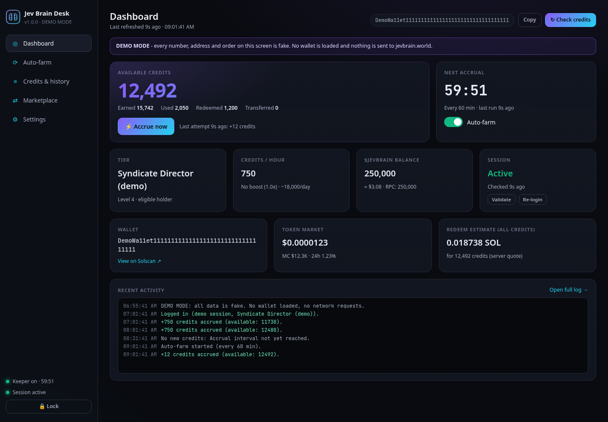
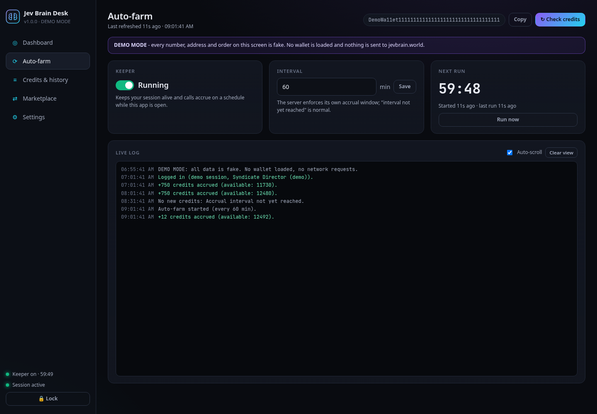
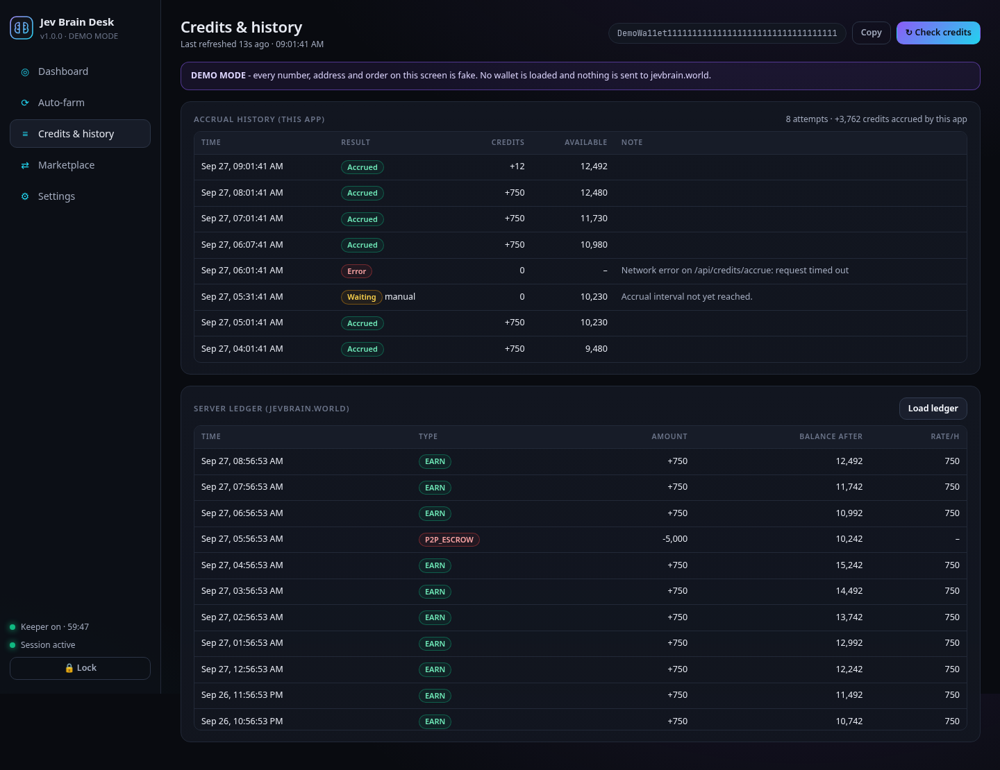
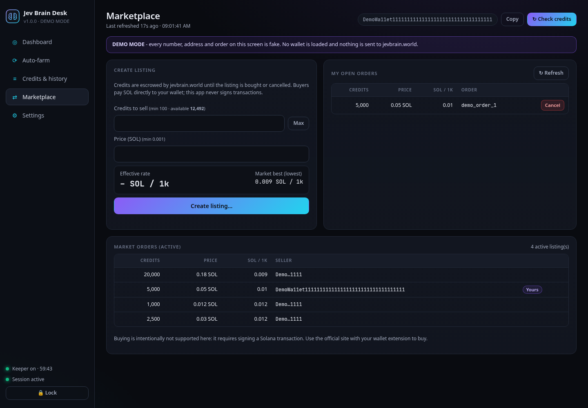
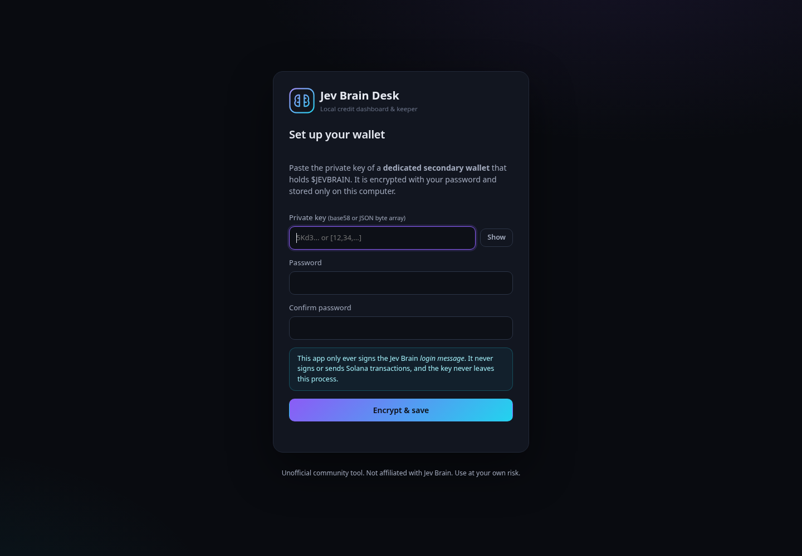
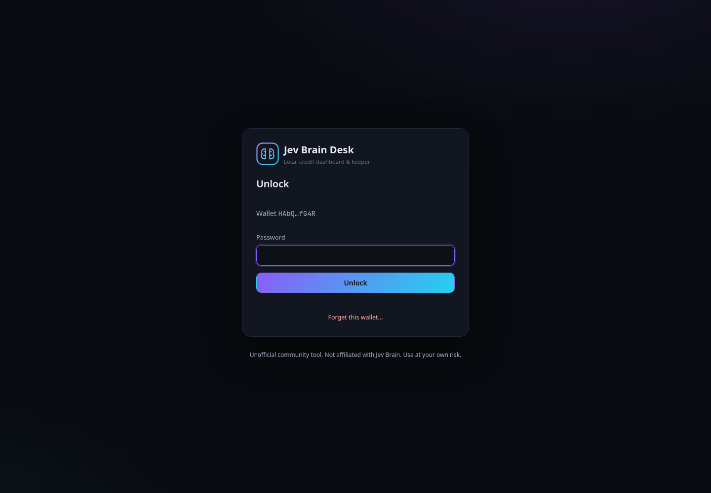
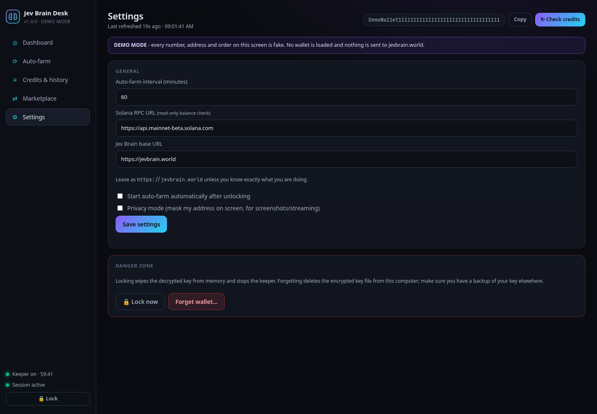
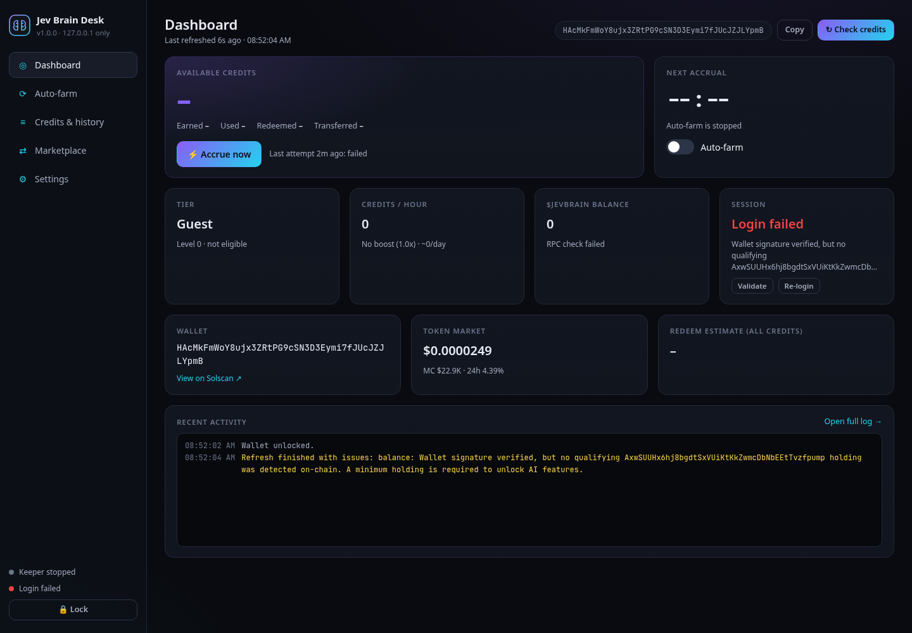

<p align="center">
  
</p>

<h1 align="center">Jev Brain Desk</h1>

<p align="center">
  A local, open-source dashboard and auto-farm keeper for <a href="https://jevbrain.world">jevbrain.world</a> holder credits.<br>
  Runs on <code>127.0.0.1</code>, keeps your key encrypted, and <b>never signs transactions</b>.
</p>

> **Unofficial community tool.** Not affiliated with, endorsed by, or supported by Jev Brain / jevbrain.world. Use at your own risk. See [Disclaimer](#disclaimer).

---

## Contents

- [What it does](#what-it-does)
- [Screenshots](#screenshots)
- [Requirements](#requirements)
- [Install](#install)
- [Usage](#usage)
- [Security](#security)
- [Configuration](#configuration)
- [API endpoints used](#api-endpoints-used)
- [Project structure](#project-structure)
- [Development](#development)
- [FAQ](#faq)
- [Disclaimer](#disclaimer)
- [License](#license)

## What it does

[jevbrain.world](https://jevbrain.world) is an "AI Developer Workspace" built around the Solana token **$JEVBRAIN**
(mint `AxwSUUHx6hj8bgdtSxVUiKtKkZwmcDbNbEEtTvzfpump`). Holders log in with a wallet signature and accrue **credits** every
hour according to their tier. Credits can be checked, redeemed, or listed on a P2P market for SOL.

Jev Brain Desk turns that into a small desktop-style app you run locally:

| Feature | Details |
| --- | --- |
| 🔐 **Encrypted wallet vault** | Paste a base58 private key (or a JSON byte array). It is encrypted with **AES-256-GCM** using a key derived from your password with **scrypt**, and stored in a local, git-ignored file. Unlock screen on startup, lock at any time, "forget wallet" to delete it. |
| 📊 **Dashboard** | Wallet address, $JEVBRAIN balance (as reported by the site **and** cross-checked via Solana RPC `getTokenAccountsByOwner`), USD value, tier, credits/hour (incl. boost), available / earned / used / redeemed credits, session status, next-accrual countdown, token price and a redeem estimate. |
| ⟳ **Auto-farm keeper** | Start/stop toggle, configurable interval (default 60 min), automatic re-login when the session is invalid, retries with exponential backoff (1 → 2 → 4 … 30 min), live log panel. Runs while the app is open. |
| ≡ **Credits & history** | Manual "Check credits" refresh, "Accrue now" button, a local log of every accrual attempt, and your server-side credit ledger. |
| ⇄ **Marketplace** | Create a listing (credits + price in SOL, live SOL-per-1k rate, lowest market rate for reference), view your open orders, cancel an order, and browse all active market orders. Every create/cancel requires a confirmation dialog. |
| ⚙ **Settings** | Interval, Solana RPC URL, base URL, auto-start keeper on unlock, and a privacy mode that masks your address on screen. |

What it deliberately does **not** do: buy listings, burn/redeem credits for SOL, transfer credits, or anything that
requires signing a Solana transaction. Use the official site with your wallet extension for those.

## Screenshots

> All screenshots use **demo mode** (`npm run demo`) or a throwaway generated keypair. Every address, balance,
> tier and credit number shown is **fake** (e.g. the wallet `DemoWa11et1111…`).

| Dashboard | Auto-farm |
| --- | --- |
|  |  |

| Credits & history | Marketplace |
| --- | --- |
|  |  |

| First-run setup | Unlock | Settings |
| --- | --- | --- |
|  |  |  |

Clean error handling for a wallet that does not hold $JEVBRAIN (throwaway test key):



## Requirements

- **Node.js 20 or newer** (uses the built-in `fetch`, `crypto.scrypt`, and `node:test`)
- Windows, macOS or Linux
- A Solana wallet that holds $JEVBRAIN. **Use a dedicated secondary wallet** (see [Security](#security)).

Only two runtime dependencies: [`tweetnacl`](https://github.com/dchest/tweetnacl-js) (ed25519 signatures) and
[`bs58`](https://github.com/cryptocoinjs/bs58) (base58 encoding). No build step, no frameworks, no telemetry.

## Install

```bash
git clone https://github.com/<your-account>/jevbrain-desk.git
cd jevbrain-desk
npm install
npm start
```

Just want to look around first? `npm run demo` starts the UI with clearly labeled **fake data** - no wallet,
no key, and no network requests.

`npm start` starts the local server, prints the URL (default `http://127.0.0.1:4777/`) and tries to open it in
your browser. Use `npm run start:no-open` to skip opening the browser.

One-click launchers are included too:

- **Windows:** double-click `start.bat`
- **macOS / Linux:** `./start.sh`

Both install dependencies on first run.

## Usage

1. **First run - set up your wallet.** Paste the private key of your holder wallet (base58, as exported from Phantom /
   Solflare, or the JSON byte array from `solana-keygen`). Choose a password (min. 8 characters). The key is encrypted
   and saved to `data/vault.json`; the public address is shown.
2. **Unlock.** On every start you enter your password. The decrypted key only lives in the memory of the local Node
   process until you lock the app or quit.
3. **Dashboard.** Click **Check credits** to refresh. The app logs in automatically (signing only the Jev Brain login
   message), then shows your tier, rate, balances and session status.
4. **Auto-farm.** Flip the **Auto-farm** switch. Every *interval* minutes the keeper validates the session (re-logging in
   if needed) and calls the accrue endpoint. The server enforces its own accrual window, so a message like
   *"Accrual interval not yet reached"* is normal and not an error. Keep the app running (the browser tab can be
   closed; the keeper runs in the Node process).
5. **Marketplace.** Enter an amount (min. 100 credits) and a price in SOL; the effective rate per 1,000 credits is
   shown live. Confirm the dialog to create the listing - the credits are escrowed by jevbrain.world until the
   listing is bought or you cancel it from **My open orders**.
6. **Lock / forget.** Use **Lock** (sidebar or Settings) to wipe the key from memory. **Forget wallet** deletes the
   encrypted file (type `DELETE` to confirm).

## Security

Handling a private key is serious. This is how Jev Brain Desk limits the risk - please read it.

**What gets signed**

- The app can sign **exactly one kind of message**: the Jev Brain login challenge returned by
  `GET /api/wallet/nonce`. Before signing, the message is validated against the **full, anchored template**
  (`src/messageGuard.js`): the fixed welcome text, the explicit *"will not trigger a blockchain transaction or cost any
  gas fees"* sentence, **your** wallet address, the nonce returned by the server, and a fresh timestamp. Anything else
  is refused with *"Refusing to sign"*. If the site ever changes its login text, signing fails closed until the
  template is reviewed.
- The signer object (`src/wallet.js`) has **no generic sign method** and no transaction support. The app never builds,
  signs, or sends a Solana transaction. Solana RPC is only used for one read-only call (`getTokenAccountsByOwner`).

**Where the key lives**

- On disk: only in `data/vault.json`, encrypted with **AES-256-GCM**. The encryption key is derived from your password
  with **scrypt** (N = 2^17, r = 8, p = 1, random 16-byte salt, random 12-byte IV). The public address is bound as
  authenticated data, so tampering is detected. File permissions are set to owner-only (`0600`) where supported.
- In memory: only after unlocking, inside the Node process, in a closure that is zeroed when you lock or quit.
- **Never** sent to jevbrain.world, never sent back to the browser UI after saving, never logged. The logger additionally
  redacts anything that looks like a private key, signature or session token (defence in depth).
- The `data/` folder, `*.enc`, `.env` and logs are in `.gitignore`. **Never commit your `data/` folder.**

**Local server hardening**

- Binds to `127.0.0.1` only - it is not reachable from your network.
- Rejects requests whose `Host` header is not its own (DNS-rebinding protection) and any cross-origin `Origin`.
- Every API call must carry a custom `X-JevDesk: 1` header and POST bodies must be `application/json`, so other
  websites open in your browser cannot forge requests. No CORS is ever granted.
- Strict Content-Security-Policy (`default-src 'self'`, no inline scripts), `X-Frame-Options: DENY`, `no-store` API responses.
- Creating or cancelling a listing requires an explicit `confirm: true` flag in addition to the UI dialog.

**Base URL warning**

The login message does not contain a domain name. If you point the app at a server other than
`https://jevbrain.world`, that server receives a valid login signature for your wallet and **could use it to act on
your jevbrain.world account** (e.g. move credits). The app therefore shows a persistent warning and requires you to
type `TRUST` before switching to a non-official base URL. Only `https://` URLs are accepted (plain `http://` only for
localhost development).

**Recommendations**

- Use a **dedicated secondary wallet** that only holds the $JEVBRAIN you need for your tier - not your main wallet.
- Pick a strong, unique password. The vault is only as strong as your password.
- Keep your OS account secure: anyone who can run code as your user while the app is unlocked can read process memory.
- Review the code before you run it. It is intentionally small (about 1,200 lines of server code, no build step).

Found a security issue? Please open a private security advisory on the repository instead of a public issue.

## Configuration

Settings are editable in the **Settings** view and stored in `data/settings.json`.

| Setting | Default | Notes |
| --- | --- | --- |
| Auto-farm interval | `60` minutes | 1 - 1440. The server enforces its own accrual window. |
| Solana RPC URL | `https://api.mainnet-beta.solana.com` | Used only for the read-only balance cross-check. Use your own RPC (Helius, QuickNode, ...) if the public one rate-limits you. |
| Base URL | `https://jevbrain.world` | See the [base URL warning](#security). |
| Auto-start keeper | off | Start auto-farm automatically after unlocking. |
| Privacy mode | off | Masks your address on screen (for screenshots / streaming). |

Environment variables:

| Variable | Default | Purpose |
| --- | --- | --- |
| `PORT` / `JEVDESK_PORT` | `4777` | Local port (the next free port is used if taken). |
| `JEVDESK_DATA_DIR` | `./data` | Where the vault, settings, history and log are stored. |
| `JEVDESK_NO_OPEN` | - | Set to `1` to not open a browser (same as `--no-open`). |
| `JEVDESK_QUIET` | - | Set to `1` to not mirror log lines to the console. |
| `JEVDESK_DEMO` | - | Set to `1` for demo mode with fake data (same as `npm run demo`). |

## API endpoints used

Every endpoint below was verified in the site's own frontend (`https://jevbrain.world/app.js`) and against live
responses. Nothing is guessed.

| Method | Endpoint | Used for |
| --- | --- | --- |
| GET | `/api/wallet/nonce?address=` | Login challenge message |
| POST | `/api/wallet/verify-signature` | `{ address, signature (hex), message }` → `sessionToken` |
| GET | `/api/session/validate` | Session check (`{ valid, address }`) |
| GET | `/api/holder/eligibility?address=` | Token balance, tier, credits/hour (public) |
| GET | `/api/credits/balance?address=` | Available / earned / used / redeemed / transferred credits, boost |
| GET | `/api/credits/history?address=` | Server-side credit ledger |
| POST | `/api/credits/accrue` | `{ walletAddress }` → accrue credits |
| GET | `/api/boost/status?wallet=` | Boost multiplier and effective rate |
| GET | `/api/credits/burn-quote?credits=` | Redeem estimate (read-only quote, public) |
| GET | `/api/market-info` | Token price / market cap (public) |
| GET | `/api/p2p/orders?status=ACTIVE` | Active market orders (public); "my orders" are filtered by seller |
| POST | `/api/p2p/orders/create` | `{ sellerWallet, creditsAmount, priceSol }` |
| POST | `/api/p2p/orders/cancel` | `{ orderId, sellerWallet }` |

Authenticated calls send `Authorization: Bearer <token>` and `X-Session-Token: <token>`, exactly like the website.

## Project structure

```
jevbrain-desk/
├── src/
│   ├── server.js        # local HTTP server (127.0.0.1) + JSON API for the UI
│   ├── app.js           # app state: vault lock/unlock, dashboard snapshot, marketplace, settings
│   ├── jevClient.js     # jevbrain.world API client (session handling, auto re-login on 401)
│   ├── keeper.js        # auto-farm loop with backoff
│   ├── messageGuard.js  # strict login-message template validation
│   ├── wallet.js        # login-only signer (no generic signing, no transactions)
│   ├── vault.js         # AES-256-GCM + scrypt encrypted key storage
│   ├── keys.js          # base58 / JSON key parsing and verification
│   ├── solanaRpc.js     # read-only getTokenAccountsByOwner
│   ├── logger.js        # ring-buffer + file log with secret scrubbing
│   ├── config.js        # paths, defaults, settings validation
├── public/              # single-page UI (vanilla HTML/CSS/JS, no build step)
├── test/                # node:test unit tests (message guard, signer, vault, scrubbing)
│   └── demo.js          # demo mode with fake data (npm run demo)
├── scripts/screenshot.js# optional helper used to capture the README screenshots
├── docs/                # screenshots
├── start.sh / start.bat # launchers
└── data/                # created at runtime, git-ignored (vault, settings, history, log)
```

## Development

```bash
npm test          # unit tests (uses throwaway keys generated at runtime)
npm start         # run the app
npm run demo      # run the UI with fake demo data (no wallet, no network)
```

To regenerate the screenshots (optional), run the demo and capture it - never use a real wallet for screenshots:

```bash
npm i --no-save puppeteer-core
PORT=4777 npm run demo -- --no-open &
CHROME_PATH=/path/to/chrome node scripts/screenshot.js http://127.0.0.1:4777 docs
```

## FAQ

**Does the browser tab need to stay open for auto-farm?**
No. The keeper runs in the Node process. Closing the tab is fine; closing the terminal / stopping `npm start` stops it.

**I see "Accrual interval not yet reached". Is something broken?**
No. The server decides when new credits can be accrued. The keeper simply tries again at the next interval.
Note that the server also books accrued credits when your balance is read, so the ledger may show entries that the
keeper did not trigger.

**Login fails with "no qualifying ... holding was detected on-chain".**
The wallet does not hold enough $JEVBRAIN for any tier (or the RPC used by the site had a hiccup). The app handles this
cleanly and the keeper backs off and retries.

**Can I run this and another keeper (or the website) at the same time?**
Yes. jevbrain.world allows multiple concurrent sessions for the same wallet; logging in here does not log you out elsewhere.

**Why can't I buy listings or redeem credits for SOL here?**
Buying requires signing a Solana transaction, and this app refuses to sign anything except the login message. Redeeming
and transferring are left to the official site on purpose to keep this tool's attack surface minimal.

**I forgot my password.**
The vault cannot be decrypted without it. Use **Forget this wallet…** on the unlock screen and set it up again with your
private key.

**Can I try it without a wallet?**
Yes: `npm run demo`. Everything shown is fake and a purple "DEMO MODE" banner is always visible.

**Is my private key sent anywhere?**
No. It is decrypted only inside the local Node process and used only to sign the login message. See [Security](#security).

**Where is my data stored?**
In the `data/` folder next to the app (or `JEVDESK_DATA_DIR`). Delete that folder to remove everything.

**Can I change the port?**
Yes: `PORT=5000 npm start` (or `set PORT=5000` on Windows before `start.bat`).

## Disclaimer

This project is an **independent, unofficial** tool and is **not affiliated with, endorsed by, or connected to** Jev
Brain, jevbrain.world, or the $JEVBRAIN token team. Names are used only to describe compatibility.

- It interacts with a third-party service whose API may change or disappear at any time without notice.
- Credits, tiers, rewards and marketplace behaviour are entirely controlled by the third-party service.
- You are solely responsible for your private keys, funds, credits and for complying with the service's terms and
  your local laws. Nothing here is financial advice.
- The software is provided **"as is", without warranty of any kind**. The authors are not liable for any loss of
  funds, credits, or data. **Use at your own risk.**

## License

[MIT](LICENSE)
